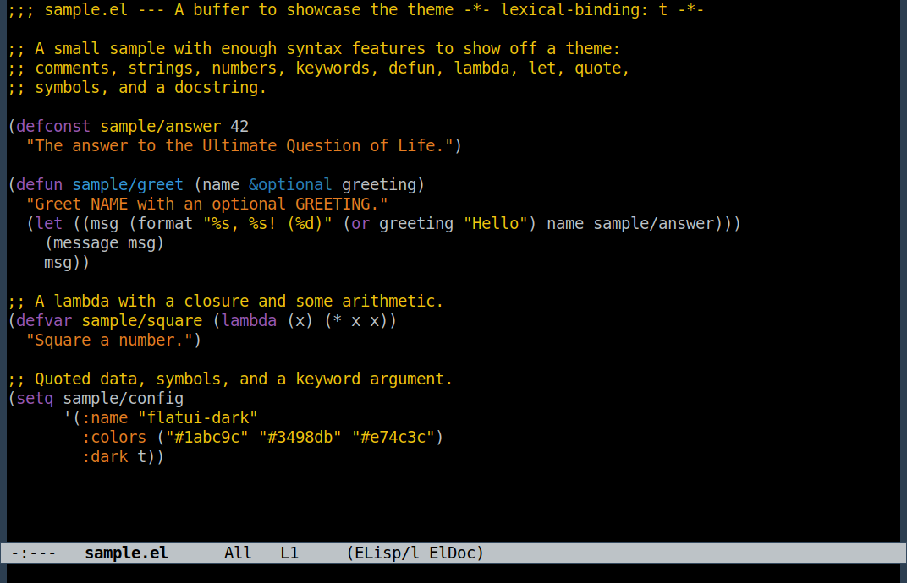

#+TITLE: FlatUi Dark Theme

A dark theme for Emacs, using the [[https://flatuicolors.com/][FlatUI colors]],
rebuilt on the [[https://github.com/protesilaos/modus-themes][modus-themes]] engine.

Rather than defining ~550 faces by hand, it declares a complete FlatUI *palette*
and lets the modus-themes engine generate its full face set from it.

[[https://melpa.org/#/flatui-dark-theme][file:https://melpa.org/packages/flatui-dark-theme-badge.svg]]

* Requirements

- Emacs 29.1+
- [[https://github.com/protesilaos/modus-themes][modus-themes]] 5.0.0+ (the version
  that provides the theme-building API ~modus-themes-theme~)

* Installation

** MELPA

You can install the theme using the packages on [[https://melpa.org/][MELPA]], see the
[[https://melpa.org/#/getting-started][Getting Started]] page for instructions for adding the MELPA
repository to your configuration. Then use ~M-x package-list-packages~, select
~flatui-dark-theme~ from the list by pressing ~i~, then press ~x~ to execute the
changes. At that point, the package (and its ~modus-themes~ dependency) will be
installed.

* Usage

In Emacs you can just use ~M-x customize-themes~ to select themes.

If you want to load the theme in your ~.emacs~ or similar you can add:

#+BEGIN_SRC elisp
(load-theme 'flatui-dark t)
#+END_SRC

and the theme should be loaded and activated on startup.

The theme is registered as a modus-themes derivative, so it also appears in
~modus-themes-registered-items~.

** Extending the palette

#+BEGIN_SRC elisp
;; extend the palette with extra named colors
(setq flatui-dark-modus-palette-user '((my-accent "#2ecc71")))

;; override existing palette entries
(setq flatui-dark-modus-palette-overrides '((keyword "#2ecc71")))
#+END_SRC

* Screenshot
#+CAPTION: FlatUI Dark screenshot

